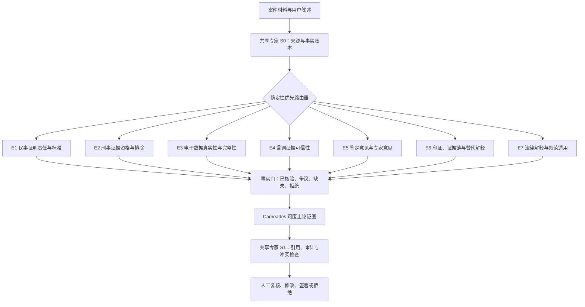

# 中国证据推理 MoE 架构研究报告

版本：0.1  
研究日期：2026-07-27  
项目代号：CLES-MoE（Chinese Legal Evidence-Symbolic Mixture of Experts）

## 摘要

本报告不是对 Carneades 英文界面的完整直译，也不是把通用大模型接到法律数据库后的
产品说明。它提出一种面向中国证据推理的神经符号混合架构：以大语言模型或神经 MoE
承担材料读取、候选事实抽取、证据类型识别和候选论证生成；以可解释的法律专家路由层
选择民事、刑事、电子数据、证人证言、鉴定意见、证明责任和法律解释模块；以事实账本
阻止未经核验的推测进入推理；最终由 Carneades 式可废止论证图完成支持、反对、例外、
证明责任和形式评价，并由法律专业人员确认输出。

该架构的核心主张是：

> 法律 MoE 的壁垒不应只是更多参数，而应是可版本化的专家规则、可追溯的事实账本、
> 可复算的论证图和可由人推翻的责任链。

本报告将这种原创性综合方案称为 CLES-MoE。MoE、Carneades、论证型式、事实账本、
检索增强和人工复核都不是本项目发明；本项目的研究贡献在于，把这些方法按照中国证据
制度的法域、程序、证据类型和审计要求重新分层、组合并定义接口。

本报告以公开法律规则、原始技术论文和中国法律论证研究为依据。各构件的理论来源和
项目新增部分见[研究贡献与来源说明](研究贡献与来源说明.md)。

## 一、研究问题与边界

### 1. 研究问题

1. 为什么 Carneades 不能通过逐词翻译直接成为中国证据推理系统？
2. 神经网络 MoE 如何与可废止法律论证结合，而不是制造更多不可审计的概率判断？
3. 如何将“用户可能是……”“材料大概表明……”这类模型推测挡在法律事实层之外？
4. 如何把中国诉讼中的证明责任、证明标准、证据资格和真实性审查表示为可复核结构？
5. 哪些部分可以在现有 Carneades 4 上实现，哪些需要重构计算内核？

### 2. 研究边界

- 本阶段聚焦中国民事与刑事证据推理，优先处理电子数据真实性。
- 本阶段是研究与教学原型，不作自动裁判，不生成最终法律意见。
- 本阶段没有训练新的参数级神经 MoE；仓库中的“专家路由”是可解释的系统架构设计。
- 本阶段不把论证权重解释为事实概率、胜诉率或有罪概率。
- 研究观点、法律规则和软件来源均通过来源台账及参考文献进行追溯。

## 二、研究基础

### 1. Carneades 的可取之处

Gordon、Prakken 与 Walton 的 Carneades 模型把证明标准应用到逐个争点，并通过普通
前提、推定前提和例外分配不同的提出证据责任。批判性问题可以被表示为前提或例外，使
某一前提的证明责任与最终结论的说服责任分开，也可以随对话阶段变化。

王彬、陈汉睿从中国法律论证视角研究 Carneades，讨论其多层结构、可废止推理、批判性
问题、证明责任以及论证评价。该研究提示了中国法语境下连接形式论证与案件分析的可能，
本项目据此提出不同的工程问题：如何限制神经模型的事实写入权，如何按程序和证据类型
路由规则模块，以及如何保存可复核的来源、事实和论证记录。

Carneades 适合作为本架构的符号内核，因为它能把结论拆成可以质疑的前提，把支持论证、
反对论证和对推理连接的攻击分开，并输出可复算的论证图。它适合做“论证辅助器”，不
适合被包装成自动事实裁判器。

### 2. 现有 Carneades 4 的中国化缺口

代码审阅显示，当前 Go 内核只内置 `PE`、`CCE`、`BRD` 三个名称，并以固定数值差和
反方最大权重判断争点。`PE` 比较正反方最强论证；`CCE` 和 `BRD` 又叠加固定阈值。
这带来五个直接问题：

1. `PE` 不能直接翻译为中国民事诉讼的“高度可能性”。中国规则不仅比较双方证据强弱，
   还要求法官对负证明责任一方主张的待证事实形成高度可能性的确信。
2. 代码中的 `BRD` 只是一个形式算法，不能自动等同于中国刑事诉讼中“证据确实、充分”
   与“综合全案证据排除合理怀疑”的复合要求。
3. 当前 `Resolve` 逻辑选出一个胜方后把其他立场全部标为 `out`，不充分保留“材料缺失”
   “真伪不明”“尚待质证”等程序状态。
4. 当前权重函数主要比较论证权重，不能代替对证据真实性、合法性、关联性和证明力的
   分层审查。
5. 当前 `assumptions` 是计算输入；若直接把模型抽取的候选事实放进去，会把语言模型的
   推测偷换成已接受事实。

因此，本项目不能只改界面文案。证明标准、未知状态、事实入口和专家选择都必须成为显式
模块。

### 3. 中国证据规则对架构的约束

中国民事诉讼的一般证明标准是“高度可能性”，反证达到使待证事实真伪不明即可导致负
证明责任一方承担不利后果；欺诈、胁迫、恶意串通、口头遗嘱和赠与等特定事实适用更高
标准。该结构表明，路由器至少要识别“程序类型、待证事实类型、谁负证明责任、是本证
还是反证”。

刑事诉讼中的有罪认定不仅要求排除合理怀疑，还要求定罪量刑事实均有证据证明、据以定案
的证据经法定程序查证属实。电子数据还要分别审查真实性、完整性、收集提取合法性以及
无法补正的排除后果。故刑事专家不能只是把 `standard` 字段设成 `BRD`。

民事电子数据真实性审查涉及系统环境、保存传输提取、正常业务形成、主体适当等因素。
特定来源的电子数据可能获得可反驳的真实性推定。区块链只能支持上链后是否被篡改，不能
当然证明上链前内容真实。以上规则天然适合用“普通前提、推定前提、例外、批判性问题”
建模。

最高人民法院关于人工智能司法应用的意见要求辅助结果只能作为参考，司法裁判和责任仍
由裁判者承担；系统应当可解释、可测试、可验证并接受审查评估。这决定了 CLES-MoE 的
最终输出必须是可审计账本和论证图，而不是不可见的思维链。

## 三、为什么采用双层 MoE

### 1. 参数级神经 MoE

1991 年的 Adaptive Mixtures of Local Experts 已提出由多个局部网络处理不同子任务。
现代 Switch Transformer 将每个输入稀疏路由到少量参数专家，以较稳定的计算成本扩大
模型容量。DeepSeekMoE 又提出细粒度专家切分与共享专家隔离，以提高专家专门化并减少
冗余。

参数级 MoE 的优势是容量和专门化，但其“专家”通常是训练中形成的参数子网络。某个
专家是否稳定对应“刑事证据”或“电子数据”并无天然法律保证，路由概率也不是法律上的
管辖、证明责任或证据资格判断。

### 2. 系统级法律专家路由

CLES-MoE 在参数级 MoE 之外增加一层规则可见、版本可控的专家路由。系统级专家不是
拟人化角色，也不只是多个 Agent，而是具有明确输入、法源、规则版本、输出字段和拒绝
条件的法律模块。

参数级 MoE 负责“读懂和提出候选”；系统级 MoE 负责“选择适用规范和检查条件”；符号
内核负责“计算论证关系”；人类负责“确认事实、解释法律并承担决定责任”。

### 3. 两层之间的红线

- 神经层不得直接写入“已查证属实”“应予采信”“达到证明标准”等字段。
- 神经层输出必须以 `candidate` 标记，并附材料定位和抽取置信信息。
- 规则路由优先于学习路由；法域、程序和责任冲突时必须停止并要求人工选择。
- 任何专家都不能绕过事实门和法源版本校验直接形成最终结论。
- 不保存或公开模型隐藏思维链；保存的是输入、路由、证据定位、规则版本、论证节点、
  计算结果和人工操作。

## 四、CLES-MoE 总体架构



### 1. 共享专家

**S0 来源与事实账本专家，始终激活**

- 为材料生成稳定标识、版本、页码或时间戳定位；
- 区分用户陈述、材料记载、系统抽取、人工确认和司法认定；
- 记录原件、复制件、哈希、提取过程、保管链和访问日志；
- 将缺失事实保持为 `unknown`，不得自动补齐。

**S1 引用、审计与冲突专家，始终激活**

- 校验法源名称、发布机关、条文、版本和生效状态；
- 检查不同法域、程序和证明标准是否混用；
- 生成可复算的路由记录、论证记录和人工修改记录；
- 检查形式结果是否被自然语言扩大解释。

这种设计借鉴了 DeepSeekMoE 的“共享专家隔离”思想，但用途不同：这里不是复现其神经
网络结构，而是把来源和审计设为所有法律任务不得绕过的共同能力。

### 2. 路由专家

| 编号 | 专家模块 | 触发条件 | 主要输出 | 必须拒绝的情况 |
|---|---|---|---|---|
| E1 | 民事证明责任与标准 | 民事、商事、家事等 | 本证/反证、责任主体、适用标准 | 程序或待证事实类型不明 |
| E2 | 刑事证据资格与排除 | 刑事侦查、审查起诉、审判 | 合法性、补正、排除、定案资格 | 取证过程材料缺失 |
| E3 | 电子数据真实性与完整性 | 聊天、日志、平台数据、链上存证 | 来源、系统、提取、哈希、完整性、推定与反驳 | 只有截图且来源无法定位 |
| E4 | 言词证据可信性 | 证人证言、被害人陈述、供述 | 感知、记忆、表达、偏见、一致性批判问题 | 把一致性自动等同真实性 |
| E5 | 鉴定与专家意见 | 鉴定意见、有专门知识的人意见 | 资质、领域、方法、数据、可重复性、冲突意见 | 只依据专家身份 |
| E6 | 印证与替代解释 | 多项间接证据、证据链 | 独立来源、循环印证、缺口、竞争假说 | 用同源材料制造虚假印证 |
| E7 | 法律解释与规范适用 | 规则含义或效力存在争议 | 法源层级、解释型式、支持与反对理由 | 无有效法源或版本冲突 |

一个任务可路由到多个专家。例如，刑事案件中的聊天记录至少激活 S0、E2、E3、E6 和
S1。专家之间发生冲突时，不以多数投票得出结论，而是把冲突转成论证图中的争点。

### 3. 确定性优先路由器

路由分两步：

1. **规则路由**：依据人工确认的法域、程序、阶段、证据类型和争点选择必须激活的专家。
2. **候选路由**：神经模型可以建议额外专家，但建议必须说明触发片段，不能关闭规则指定
   的专家。

路由输出最少包含：

```yaml
jurisdiction: CN
procedure: civil
stage: evidence_review
issue_type: electronic_data_authenticity
evidence_types: [electronic_data]
required_experts: [S0, E1, E3, S1]
suggested_experts: [E6]
missing_fields: []
conflicts: []
human_confirmed: false
router_version: cles-router-0.1
```

当 `jurisdiction`、`procedure` 或 `issue_type` 未确认时，系统只能整理材料和提出问题，
不得计算证明标准。

## 五、事实门与三本账

### 1. 来源账本

来源账本回答“这句话从哪里来”，至少包含：

- `source_id`、材料名称、版本和取得方式；
- 页码、段落、时间戳、文件偏移等可重复定位；
- 原件或复制件状态、哈希与保管记录；
- 访问权限、个人信息和保密级别；
- 抽取工具、模型版本与时间。

### 2. 事实账本

事实账本回答“系统现在把它当作什么”，而不是“它听起来像什么”。建议状态为：

| 状态 | 含义 | 可否作为 Carneades 已接受输入 |
|---|---|---|
| `candidate` | 模型从材料中抽取的候选命题 | 否 |
| `asserted` | 某一方明确主张 | 否，仅作为主张节点 |
| `admitted` | 对方承认或依法无需证明 | 需记录依据后可以 |
| `disputed` | 已被明确争议 | 否，进入争点 |
| `verified` | 人工按来源核验 | 可以，但仍可被反驳 |
| `rejected` | 经核验不应作为输入 | 否 |
| `unknown` | 材料不足或尚未调查 | 否，不得猜测 |

每条事实还应记录主张方、反对方、证明责任、材料定位、核验人、核验时间和历史版本。

### 3. 论证账本

论证账本回答“为什么当前形式结果如此”，包括：

- 争点与候选立场；
- 支持论证、反对论证和截断论证；
- 普通前提、语境预设、法律推定和例外；
- 每个节点的法源或事实来源；
- 适用专家、路由理由和规则版本；
- 证明标准插件及参数；
- `in/out/undecided` 结果和人工异议。

这里记录的是外部可审计的理由结构，不是模型隐藏思维链。

## 六、中国证据规则的形式映射

### 1. 普通前提、语境预设、法律推定和例外必须分开

英文 `assumption` 在 Carneades 代码中是计算语境里的预设输入，不能一律译成中国法上的
“推定”。本项目采用以下区分：

- `ordinary premise`：普通前提，需要提出证据支持；
- `context assumption`：语境预设，只在已声明的模拟条件内成立；
- `legal presumption`：法律推定，必须绑定具体法源、适用条件和反驳方式；
- `exception`：例外或抗辩条件，由规则指定的一方提出支持；
- `unknown`：未知事实，不属于任何形式的预设。

### 2. 证明标准不得直接对译

| Carneades 现有值 | 原始含义 | 中国化处理 |
|---|---|---|
| `PE` | 正方最强论证权重高于反方 | 仅称“PE 计算标准”，不得标成中国民事高度可能性 |
| `CCE` | 在 PE 上增加固定差值 | 暂无直接中国法对应 |
| `BRD` | 在 CCE 上限制反方权重 | 不得自动等同中国刑事排除合理怀疑 |

后续应新增可插拔标准：

- `CN_CIVIL_HIGH_PROBABILITY`：区分本证和反证，并保留真伪不明；
- `CN_CIVIL_SPECIAL_BRD`：仅在法定特殊事实类型触发；
- `CN_CRIMINAL_SUFFICIENT_AND_BRD`：同时检查证据覆盖、程序查证和合理怀疑；
- `CN_EVIDENCE_ADMISSIBILITY_GATE`：先判断是否可作为认定基础，再进入证明力评价。

这些插件仍不能把法官内心确信压缩成固定概率。它们应检查必要条件、反方论证和未解决的
合理替代解释，并把价值判断留给人工复核。

### 3. 电子数据真实性专家的批判性问题

E3 至少提出以下问题：

1. 数据的具体来源和原始存储介质是什么？
2. 生成、存储、传输所依赖的系统是否正常，异常有何影响？
3. 收集、提取过程能否重现，是否有笔录、清单和必要签名？
4. 完整性校验值、备份、封存状态或访问日志是否相互一致？
5. 是否存在增加、删除、修改、剪辑或无法解释的处理痕迹？
6. 数据是否在正常业务活动中形成，保存主体是否适当？
7. 中立平台、公证或约定方式是否触发可反驳推定？
8. 区块链只能证明上链后未篡改时，上链前真实性由什么材料支持？
9. 相反证据攻击的是数据本身、提取程序，还是从数据到待证事实的推论？

这些问题应分别路由到普通前提、推定、例外或截断者，不能简单加总为一个“真实性分数”。

## 七、自然语言输出规范

### 1. 禁止的输出

- “用户可能是在该银行逾期。”
- “这份聊天记录应该是真的。”
- “模型认为被告有罪的概率为 87%。”
- “PE 已满足，所以达到中国民事高度盖然性。”

### 2. 合格的输出

1. **已核验事实**：仅列 `verified/admitted` 项及来源定位。
2. **当事人主张**：标明是谁主张，不改写为事实。
3. **争议事实**：列支持、反对材料和当前缺口。
4. **缺失事实**：说明缺少什么、为何影响哪个专家或论证节点。
5. **适用规则**：列法源、版本、条文与适用前提。
6. **形式结果**：使用“当前论证图中获得支持/未获支持/未决”。
7. **边界声明**：说明形式结果不等于司法认定，列出人工确认点。

模型不知道时应输出“材料未提供”或提出定向问题，而不是用“可能”补全人物身份、行为或
法律关系。

## 八、与普通 Agent 架构的区别

主 Agent 加子 Agent 是任务编排方式；参数级 MoE 是模型内部按 token 或表示激活参数；
CLES-MoE 的系统级专家则是按法律元数据路由到可审计规则模块。三者可以组合，但不能
互相冒充。

一个 Agent 可以调用多个 CLES 专家；一个 CLES 专家也可以由规则引擎、检索器和模型
共同实现。决定其法律身份的是可见的输入输出契约、法源和拒绝条件，不是提示词里写了
“你是一名资深律师”。

## 九、验证方案

### 1. 数据集分层

- 无争议的合成最小案例，用于验证图结构和责任转移；
- 经脱敏的真实材料片段，用于事实抽取和来源定位；
- 专家标注争点集，用于路由和批判性问题覆盖；
- 对抗案例，用于测试同源印证、伪造引用、跨法域混用和缺失事实补全；
- 法律版本变化集，用于测试失效法源和规则更新。

### 2. 指标

| 指标 | 目标 |
|---|---|
| 强制专家路由召回率 | 关键专家不得漏路由 |
| 法域/程序误路由率 | 接近零，冲突时拒绝 |
| 候选事实误入已核验层 | 零容忍 |
| 来源定位可复现率 | 每个事实和规则可回到原文 |
| 批判性问题覆盖率 | 专家基准问题均被检查 |
| 伪造引用率 | 零容忍 |
| 同输入同版本复算一致性 | 符号层完全一致 |
| 人工纠错成本 | 记录每个节点的修改时间 |
| 跨法域证明标准混用率 | 零容忍 |

### 3. 对照实验

至少比较四组：

1. 通用大模型直接回答；
2. 通用大模型加检索；
3. 多 Agent 辩论；
4. CLES-MoE 加 Carneades 事实门和论证图。

评测重点不是文风或最终答案相似度，而是事实越权、引用真实性、争点覆盖、反方论证召回、
证明责任正确性和人工可复核性。

## 十、实施路线

### 阶段 A：研究型汉化

- 建立非直译术语表；
- 明确 `PE/CCE/BRD` 与中国证明标准不可直接对应；
- 用中国电子数据规则重写教学示例；
- 在界面显著展示研究边界。

### 阶段 B：事实账本与确定性路由

- 定义来源、事实、路由和论证四类 Schema；
- 先支持民事电子数据真实性；
- 所有候选事实必须人工确认后进入图。

### 阶段 C：中国证明标准插件

- 重构 `Standard` 接口，移除硬编码三值限制；
- 增加真伪不明和程序性排除状态；
- 分离证据资格门与证明力评价；
- 为每个插件编写法源测试、正例、反例和边界例。

### 阶段 D：专家包

- 民事证明责任专家；
- 刑事电子数据专家；
- 证人证言、鉴定意见和印证专家；
- 法律解释专家。

每个专家包必须包含规则、法源版本、批判性问题、测试和变更日志。

### 阶段 E：神经 MoE 接入

- 从 dense baseline 开始验证中文法律 tokenizer、抽取和路由标签；
- 再训练小型参数级 MoE，设置共享中文法律语言专家和细粒度证据专家；
- 神经层只输出候选结构，不拥有最终事实写入权；
- 用符号执行结果、人工修订和来源一致性作为训练信号。

## 十一、结论

Carneades 的价值不在于把法律变成三个权重阈值，而在于把结论拆成可争辩、可废止、可
追责的结构。MoE 的价值也不在于给若干 Agent 起“专家”名字，而在于以可控成本形成
专门能力并明确路由。两者结合后，中国证据推理系统的合理形态应当是：

> 神经模型负责读，专家路由负责选，事实门负责挡，Carneades 负责算，人类负责判。

这一路径比直接翻译更慢，但形成的不是一次性中文界面，而是可以积累法源、论证型式、
审计数据和专家评测的研究基础设施。

## 参考资料

完整来源、用途和证据等级见[研究来源台账](研究来源台账.md)。主要资料包括：

1. 王彬、陈汉睿：《法律论证的卡尔尼德斯模型——一种法律人工智能的建模理论》，
   《南大法学》2026 年第 1 期。
2. Gordon, Prakken & Walton, *The Carneades Model of Argument and Burden of
   Proof*, Artificial Intelligence 171 (2007), DOI: 10.1016/j.artint.2007.04.010.
3. Jacobs et al., *Adaptive Mixtures of Local Experts*, Neural Computation 3(1),
   1991.
4. Fedus, Zoph & Shazeer, *Switch Transformers*, JMLR 23 (2022).
5. Dai et al., *DeepSeekMoE*, 2024.
6. 最高人民法院关于适用《中华人民共和国民事诉讼法》的解释。
7. 最高人民法院《关于民事诉讼证据的若干规定》。
8. 最高人民法院关于适用《中华人民共和国刑事诉讼法》的解释。
9. 《人民法院在线诉讼规则》及其理解与适用。
10. 最高人民法院《关于规范和加强人工智能司法应用的意见》。
